  

  
  
  

I founded GoCarbonTracker, which reads what companies publish about their climate performance and turns it into claims a reader can check, each traced to a document and page. Before that, eight months in carbon-data delivery at DitchCarbon and six years launching products at Delhivery.

It is built for Scope 3 and procurement teams who today rely on supplier questionnaires and weeks of reading reports. It shows what each supplier has published on emissions and targets, with the page to check it against.

### Carbon, ESG and supply chain

  
  
  
  
  
  
  
  
  

### What I work with

  

### Projects

<table>
  <tr>
    <td width="50%" valign="top">
      <a href="https://gocarbontracker.net"><b>GoCarbonTracker</b></a> 
      Every figure linked to the document and page it came from.
    </td>
    <td width="50%" valign="top">
      <a href="https://hypergraph.gocarbontracker.net/automotive"><b>Tata Motors knowledge base</b></a> 
      Every flagged contradiction audited against the original reports.
    </td>
  </tr>
  <tr>
    <td width="50%" valign="top">
      <a href="https://unicef-supply.vercel.app"><b>UNICEF supplier prototype</b></a> 
      About 30 suppliers' spend and climate claims.
    </td>
    <td width="50%" valign="top">
      <a href="https://github.com/varunmoka7/resume-hypergraph"><b>resume-hypergraph</b></a> 
      Turn a resume into an interactive hypergraph page for a personal website.
    </td>
  </tr>
</table>

### Claude Code extensions

- [peer-orchestra](https://github.com/varunmoka7/peer-orchestra): multi-agent orchestration for Claude Code with themed persona agents.
- [next-steps-autopilot](https://github.com/varunmoka7/next-steps-autopilot): shows suggested next prompts above the prompt box.
- [side-chat](https://github.com/varunmoka7/side-chat): ask Claude a side question in a pane next to your work.
- [layman](https://github.com/varunmoka7/layman): say "I'm lost" and Claude explains its last reply in everyday words.
- [image-shrinker](https://github.com/varunmoka7/image-shrinker): shrinks big screenshots before Claude reads them.
- [park](https://github.com/varunmoka7/park): save a session and write a note for the next one.
- [unattended](https://github.com/varunmoka7/unattended): stops a session from asking questions when nobody is at the keyboard.
- [reddit-watch](https://github.com/varunmoka7/reddit-watch): watches subreddits and lists posts that could improve your setup.
- [disk-sweep](https://github.com/varunmoka7/disk-sweep), [read-fence](https://github.com/varunmoka7/read-fence), [skills-az](https://github.com/varunmoka7/skills-az)
